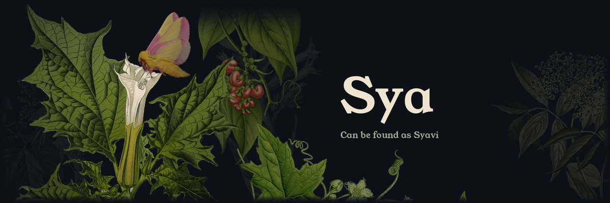
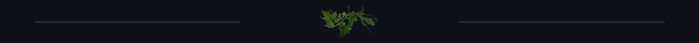
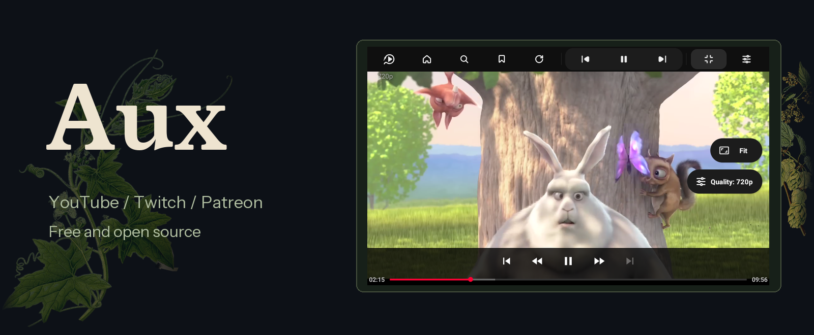
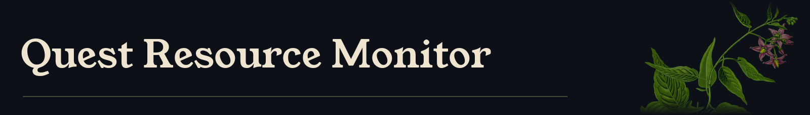

  

design, homelab things, and love of the bug world

A free and open source Android Auto app with ad blocking, SponsorBlock and support for local videos, Jellyfin and Plex

  <a href="https://github.com/Syaviii/Aux/releases/latest"><strong>Download Aux</strong></a> &nbsp; / &nbsp; <a href="https://github.com/Syaviii/Aux">Source</a>

Monitors a Quest 3 and PC over USB or wireless ADB and records sessions for export, though packaging and some metrics are still unfinished

<a href="https://x.com/Syaviiii">X / @Syaviiii</a>

